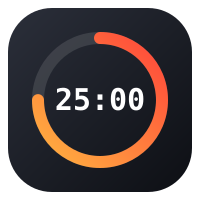
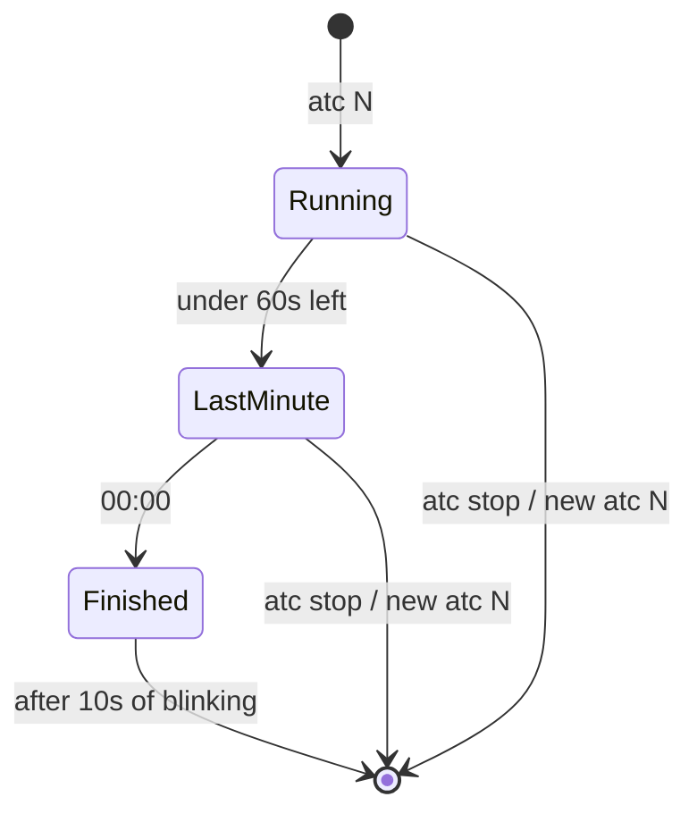

<p align="center">
  
</p>

<h1 align="center">atc</h1>

<p align="center">
  <b>An always-on-top countdown for macOS, started from the command line.</b><br>
  One command, one small timer in the corner of your screen, nothing else.
</p>

<p align="center">
  
  
  
</p>

---

`atc` puts a small translucent timer in the top-right corner of your main screen and keeps it there, above every window, on every Space, even over full-screen apps. It ignores the mouse, so clicks go straight through to whatever is underneath, and it never takes focus or shows up in the Dock. When you start it, you get your prompt back right away, because the timer runs in the background.

It's meant for timeboxing talks, Pomodoro sessions, meetings and exams, or any time you want the clock in view without another window to manage.

## Usage

```sh
atc 25      # 25-minute countdown
atc 0.5     # fractions work too: 30 seconds
atc 90      # longer runs switch to H:MM:SS
atc stop    # dismiss the running countdown
```

Running `atc <minutes>` while a countdown is already going replaces it, so there's only ever one timer on screen.

## What it looks like over time

The digits stay white for most of the run. In the last minute they turn orange. At zero they turn red, the system "Glass" sound plays, and the timer blinks for ten seconds before closing on its own.



## Install

You'll need macOS and a Rust toolchain.

```sh
git clone https://github.com/aovestdipaperino/atc.git
cd atc
cargo install --path .
```

This puts the `atc` binary in `~/.cargo/bin`.

## How it works

`atc` is a single Rust file that talks to AppKit directly through the [`objc2`](https://github.com/madsmtm/objc2) bindings, with no Swift, Electron or helper app involved. The binary re-launches itself as a background process in its own process group, so the timer keeps running after the terminal closes. The overlay is a borderless `NSWindow` at the status-bar window level. Its collection behavior lets it join every Space and sit next to full-screen apps. It always goes on the primary screen (the one with the menu bar), whichever display has keyboard focus.

Size, position, colors and the ten-second blink at the end are constants at the top of `src/main.rs`.

## License

MIT
